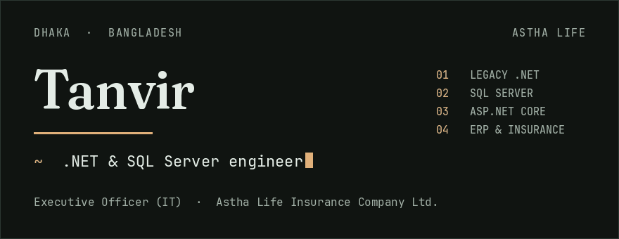

<h1 align="center">
  
</h1>

<p align="center">
  <a href="https://www.linkedin.com/in/tanvir626"><strong>LinkedIn</strong></a>
  &nbsp;·&nbsp; linkedin.com/in/tanvir626
  &nbsp;·&nbsp; Dhaka, Bangladesh
</p>

I work on enterprise and insurance systems: long-lived .NET, SQL Server, and the ASP.NET Core APIs in front of them. I am Executive Officer (IT) at **Astha Life Insurance Company Ltd.** in Dhaka.

Most days that means keeping legacy .NET maintainable, tuning SQL Server, and building the ERP and insurance applications those systems support.

## Focus

**01 · Legacy .NET**
Maintenance and modernization of ASP.NET Framework and ASP.NET Core systems that already carry live policies.

**02 · SQL Server**
Schema design and query tuning, where a slow report is a business problem.

**03 · ASP.NET Core APIs**
Web APIs the rest of the business can call, sitting on insurance and enterprise processes.

**04 · Business applications**
ERP and insurance software, where the edge cases are the work.

## Stack

| | |
| --- | --- |
| Language | C# · JavaScript |
| Web | ASP.NET Framework · ASP.NET Core · MVC · Web API |
| Data | SQL Server · Dapper · Entity Framework |
| Practice | Git |

## Currently learning

- Software architecture
- Testing
- Advanced SQL
- AI-assisted engineering

---

<details>
<summary>Run the animated profile locally</summary>

The page in this repo is the same profile in motion: the name settles, a one-row SQL portrait types itself, and a brass mark walks the study list.

```bash
npm install
npm run dev
```

Open [http://localhost:3847](http://localhost:3847).

The masthead above is `assets/masthead.gif`. Regenerate it with `python3 scripts/render_masthead.py` (Pillow, Fraunces at `/tmp/fonts/Fraunces.ttf`, JetBrains Mono), then:

```bash
gifsicle -O3 assets/masthead.gif -o assets/masthead.gif
```

</details>
